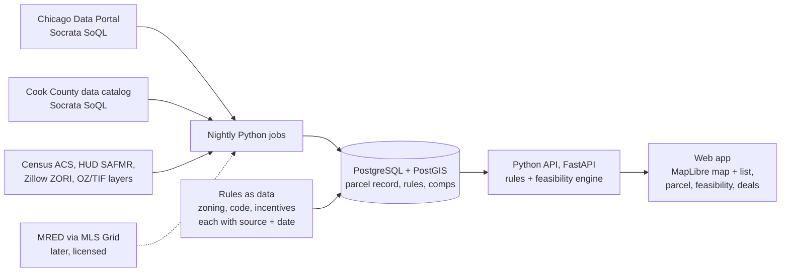

# 25x125 Version 1 Spec

2026-10-28 · Marlon · revised 2026-10-29 after the review and calibration run (docs/calibration-2026-10-29.md)

Version 1 is the site finder and feasibility screen for Chicago, built on public data first. This spec lists every data source, formula, default, and test needed to build it.

## Scope

Version 1 answers, for any Chicago parcel: what can be built, what it costs with a dollar margin, which incentives apply, and whether it makes money. It covers 2-6 unit residential and small mixed-use on standard lots.

**In version 1**

- Every Chicago parcel, searchable on a map and list.

- Zoning capacity for RS-3, RT-4, RM-4.5, RM-5, and B/C districts with -1 through -5 suffixes.

- Feasibility scenarios: by right, plus coach house, administrative adjustment, rezoning.

- Build-and-sell and build-and-hold results with dollar margins.

- Incentive flags with dollar estimates and toggles.

- Deal list, owner outreach log, one-page PDF, CSV export.

- Email sign-in (one user per account), billing, terms of use.

**Moved to version 1.1:** saved-search alerts, CSV import, teams and shared deals, the comps drawer, sensitivity sliders.

**Not in version 1**

- Suburbs, Lake County, McHenry County.

- MLS listings and MLS rent comps (added when the MRED feed is approved).

- Layout planner, entitlement tracker, budget, construction, and later modules.

- Interim, investor network, wholesale tools.

- Mobile drive-and-tap.

## Architecture

The app never queries the city or county portals live; nightly jobs copy what changed into one database, and every screen reads from there.

**Stack**

| Layer          | Choice                                                   | Why                                               |
|----------------|----------------------------------------------------------|---------------------------------------------------|
| Database       | PostgreSQL with the PostGIS mapping extension            | Standard for parcel and map data; free            |
| Data jobs      | Python scripts on a nightly schedule                     | Simple to write and test; strong data libraries   |
| Rules and math | Python, with rules stored as data tables, served by FastAPI | One engine for nightly scoring and live edits, so results never drift |
| Web app        | Next.js (TypeScript) with MapLibre; parcels as vector tiles (Martin or nightly PMTiles) | Map and list in one screen; free map rendering |
| Hosting        | A managed cloud host with a managed database             | Low upkeep at the start, roughly \$20-100 a month |
| Code           | A GitHub repository                                      | Version history and backups                       |

## Data sources and refresh

All version 1 data is free and public. Both portals answered API queries from our build environment on October 28, 2026 without an API key; production should register free app tokens to avoid throttling.

| Data                                                | Portal      | Dataset ID           | Refresh                 | Queried by us |
|-----------------------------------------------------|-------------|----------------------|-------------------------|---------------|
| Parcel universe (PIN, class, location, ward, tract) | Cook County | pabr-t5kh            | Yearly                  | Yes (2026-10-29) |
| Parcel addresses and owner mailing address          | Cook County | 3723-97qp            | Yearly (2026 year live) | Yes           |
| Parcel sales                                        | Cook County | wvhk-k5uv            | Monthly                 | Yes           |
| Assessed values                                     | Cook County | uzyt-m557            | Yearly                  | Yes (2026-10-29) |
| Residential building characteristics                | Cook County | x54s-btds            | Yearly                  | Yes (2026-10-29) |
| Zoning districts                                    | Chicago     | dj47-wfun            | As changed              | Yes (2026-10-29) |
| Building permits (with reported cost)               | Chicago     | ydr8-5enu            | Daily                   | Yes           |
| Building violations                                 | Chicago     | 22u3-xenr            | Daily                   | Yes (2026-10-29) |
| 311 requests (vacant building, vacant lot)          | Chicago     | v6vf-nfxy            | Daily                   | Yes (2026-10-29) |
| Scofflaw list                                       | Chicago     | rz4d-qp2m            | Monthly                 | Yes (2026-10-29) |
| City-owned land                                     | Chicago     | aksk-kvfp            | Weekly                  | Yes (2026-10-29) |
| Asbestos and demolition notices                     | Chicago     | qhb4-qx8k            | Daily                   | Yes (2026-10-29) |
| TIF districts                                       | Chicago     | eejr-xtfb            | As changed              | Yes (2026-10-29) |
| Enterprise Zones                                    | Chicago     | 64xf-pyvh            | As changed              | Yes (2026-10-29) |
| Historic survey and landmarks                       | Chicago     | 2u8t-236p, uct4-hrvh | As changed              | Yes (2026-10-29) |
| CTA rail stations                                   | Chicago     | 8pix-ypme            | As changed              | Yes (2026-10-29) |
| Census tract data                                   | Census API  | ACS 5-year           | Yearly                  | Not yet       |
| Condo unit characteristics (new-construction comps) | Cook County | 3r7i-mrz4            | Yearly                  | Yes (2026-10-29) |
| Parcel polygons (lot area, frontage)                | Cook County | 77tz-riq7 (2021); newer on the county GIS hub | Yearly | Found |
| Transit-served areas, fire limits, 606/Pilsen, ADU areas | City GIS | not on the data portal | As changed | To source |

Endpoints follow one pattern: `https://data.cityofchicago.org/resource/<id>.json` and `https://datacatalog.cookcountyil.gov/resource/<id>.json`, queried with SoQL (`$where`, `$select`, `$limit`).

The parcel universe (pabr-t5kh) already carries ward, community area, census tract, Assessor neighborhood and TIF district per PIN. Boundary layers for the map: community areas igwz-8jzy, wards p293-wvbd, tracts 7qjk-677h, Assessor neighborhoods pcdw-pxtg.

**Nightly job:** pull changed rows from the daily datasets, update parcel signals, recompute development scores for affected parcels, and send saved-search alerts. Yearly datasets reload when the portal publishes a new year.

## Parcel record

One row per Cook County PIN in Chicago, keyed on the 14-digit PIN. Every field stores its source and the date it was pulled.

| Field group | Fields                                                                                               | Source                                 |
|-------------|------------------------------------------------------------------------------------------------------|----------------------------------------|
| Identity    | PIN, address, lat/lon, ward, community area, census tract, Assessor neighborhood                     | Assessor parcel universe and addresses |
| Owner       | Owner name, tax-bill mailing address                                                                 | Assessor addresses                     |
| Land        | Lot area, frontage (from parcel shape), class code, vacant flag                                      | Assessor; parcel geometry              |
| Building    | Units, building sq ft, age, stories                                                                  | Assessor residential characteristics   |
| Value       | Assessed value, last sale date and price                                                             | Assessor values and sales              |
| Zoning      | District, overlays, transit-served flag                                                              | Zoning layer, CTA stations             |
| Incentives  | TIF district and expiry, Enterprise Zone, Opportunity Zone tract, historic rating or landmark        | City layers, Treasury tract list       |
| Signals     | Vacancy complaints, violations, scofflaw, demolition notice, city-owned and for sale, recent permits | City daily datasets                    |
| Computed    | Buildable units by path, development score, cost index, flags                                        | Rules engine and score                 |
| User        | Saved, deal status, notes, outreach log                                                              | App                                    |

Condo buildings have one PIN per unit; the record groups them under the building's base PIN for search and keeps unit PINs for sales history.

## Zoning rules engine

The engine stores each district's numbers as data with a code citation and effective date, so a rule change is a data edit, not a code change.

**Version 1 districts** (lot area per dwelling unit and FAR confirmed against the code)

| District | Lot area per unit | FAR | Max height (lot 25 ft wide or less)     |
|----------|-------------------|-----|-----------------------------------------|
| RS-3     | 2,500 sq ft       | 0.9 | 30 ft                                   |
| RT-4     | 1,000 sq ft       | 1.2 | 38 ft                                   |
| RM-4.5   | 700 sq ft         | 1.7 | 45 ft                                   |
| RM-5     | 400 sq ft         | 2.0 | 45 ft                                   |
| B/C -1   | 2,500 sq ft       | 1.2 | 38 ft                                   |
| B/C -1.5 | 1,350 sq ft       | 1.5 | 38 ft                                   |
| B/C -2   | 1,000 sq ft       | 2.2 | 45 ft (47 with ground-floor commercial) |
| B/C -3   | 400 sq ft         | 3.0 | 50 ft                                   |
| B/C -5   | 200 sq ft         | 5.0 | 50 ft                                   |

Sources: [B and C districts](https://codelibrary.amlegal.com/codes/chicago/latest/chicagozoning_il/0-0-0-49197), [R districts](https://codelibrary.amlegal.com/codes/chicago/latest/chicagozoning_il/0-0-0-48908). Heights rise on wider lots in B/C districts; the engine stores the full frontage table.

**Calculation steps for each parcel**

1.  Units by right = floor(lot area / lot area per unit).

2.  Floor area by right = lot area x FAR.

3.  RS-3 exception: allow 2 units on a 25-ft lot if 60% or more of buildings on the same block face have 2+ units (lot area per unit drops to 1,500).

4.  Administrative adjustment path: lot area may be 90% of the minimum, so units = floor(lot area / (0.9 x lot area per unit)); height +10%.

5.  ADU path: +1 unit for a coach house or conversion unit in RT-4 and higher and in B/C districts; RS districts only in wards that opted in. Two or more ADUs trigger the affordability rule.

6.  Rezoning path: recompute at a target district the user picks (defaults: RS-3 to RT-4, RT-4 to RM-5, RM-4.5 to RM-5, B/C -1 and -1.5 to -2, B/C -2 to -3). Targets are listed in `zoning_steps.json`.

7.  Transit-served: if within 1/2 mile of a CTA rail or Metra station or 1/4 mile of an eligible bus corridor (use the city's transit-served map when available), parking required = 0; bike parking = 1 per unit. In -3 districts, the affordable density bonus (300-350 sq ft per unit, FAR 3.5-4.0) appears as an option.

8.  Ground floor: residential allowed as of right only in B2 (and DR); other B and C districts flag a special use or adjustment.

9.  Affordable Requirements Ordinance: flag when a rezoning scenario reaches 10+ units.

10. Flags: historic rating (90-day demolition hold), 606/Pilsen surcharge district, fire limits (wood frame mostly not allowed).

Stair, sprinkler, Certificate of Occupancy and accessibility thresholds stay marked unverified until checked against the 2026 construction code (mandatory December 1, 2026).

**Not in version 1:** setbacks and building footprint (layout planner), Planned Development thresholds, landmark district design review.

## Development score

A 0-100 score that ranks parcels for development, built from five parts plus penalties. Every parcel shows the points behind its score, and users can change the weights.

| Part                | Default points | How points are earned                                                                                                                                                                                          |
|---------------------|----------------|----------------------------------------------------------------------------------------------------------------------------------------------------------------------------------------------------------------|
| Zoning upside       | 30             | Units allowed by right minus existing units, scaled: 0 extra units = 0; 3 or more extra = 30                                                                                                                   |
| Profit              | 30             | Build-and-sell return on cost at the central estimate: 0% or less = 0; 25% or more = 30; straight line between                                                                                                 |
| Acquisition signals | 20             | City-owned and for sale 10; vacant land 8; vacant-building complaint in last 2 years 6; open violations 4; scofflaw owner 6; demolition notice 6. Capped at 20. Tax delinquent (6) is added when a licensed feed exists |
| Location            | 10             | Transit-served 5; neighborhood sales in the last 12 months above the city median for that property type 5                                                                                                      |
| Incentives          | 10             | 2 points per program that applies with a dollar value, capped at 10                                                                                                                                            |
| Penalties           | up to -20      | Orange or red historic rating -10; landmark district -15; 606/Pilsen demolition surcharge -10; inside fire limits -5                                                                                           |

The profit part needs a by-right feasibility run for every parcel each night. The final score is capped between 0 and 100. Saved searches can set a minimum score, and the score recomputes nightly when signals change.

## Feasibility math

Every input below is a default the user can override. Defaults are starting values to tune against the test parcels before launch.

**Size**

- Gross floor area = the smaller of (lot area x FAR) and (units x unit size x 1.12 for halls and stairs).

- Default unit size: 1,300 sq ft for 2-flats, 1,200 for 3-flats, 1,000 for 4-6 units.

**Cost**

- Land = asking price if entered, else neighborhood vacant-land price per sq ft x lot area.

- Hard cost = gross floor area x base cost per sq ft x neighborhood adjustment (Cost model section).

- Base cost by build-spec preset (2-3 units / 4-6 units): production \$160 / \$175, standard \$200 / \$215, high \$250 / \$265 per sq ft. Default preset by the area's cost index: below 1.3 production, 1.3-1.8 standard, 1.8 and up high. Provisional until the partner contractor's job costs are in (calibration in docs/calibration-2026-10-29.md).

- Sprinklers: \$5 per sq ft of the building that has 4+ units. A detached coach house does not count toward the main building (verify).

- Hard-cost contingency: 5%.

- Soft cost: 22% of hard cost, plus \$30,000 on the rezoning path.

- Building permit fee = gross floor area x construction factor x scope factor; scope factor 0.75 with a \$2,000 minimum for 3 units or fewer, 1.0 with a \$3,000 minimum for 4+ units. Residential construction factor \$0.50 per sq ft until confirmed from the city's fee tables.

- Financing and carry, on cost before financing (land + hard + sprinklers + contingency + soft + permit): interest = 0.65 x that cost x 8% x (12/12 x 0.55 + 6/12); property tax and insurance = 1.5% x that cost x 18/12.

- Total cost = land + hard + sprinklers + contingency + soft + permit + financing and carry.

**Build and sell**

- Sale value = units x neighborhood new-construction sale price per unit, with a low and high from the comps (Rents and sale values).

- Net sale = sale value x 0.94 (commission, closing, and the seller's transfer tax share).

- Profit = net sale - total cost. Return on cost = profit / total cost.

- Max land price = net sale / (1 + target return) - (total cost - land). Target return: 15%.

**Build and hold**

- Net operating income = monthly rent x 12 x units x 0.95 (vacancy) x 0.65 (after operating costs and taxes).

- Yield on cost = net operating income / total cost.

- Value = net operating income / cap rate. Default cap rate: 6.25%.

**Margins in dollars**

- Total cost shows as the central figure with -20% / +30% margins at this stage, in dollars, applied to every line except land.

- Profit shows as a range: low net sale minus high cost, to high net sale minus low cost, with the central profit between.

- Max land price shows the central figure and the low case (low sale, high cost).

## Cost model

Hard cost = base cost per sq ft x a neighborhood adjustment, shown with dollar margins. The base comes from published Chicago cost ranges; the neighborhood adjustment comes from 836 city permits for new 2-6 unit buildings.

> Chart in the live doc. Data behind it: `data/reference/cost_index_by_area.csv`. Source: Chicago building permits (ydr8-5enu) · 836 new 2-6 unit residential permits, Jan 2022 to Oct 2026 · pulled Oct 28, 2026

Reported costs run low because permit fees are based on them, so they set how neighborhoods compare, not the dollar level. Part of the spread is finish level (Lincoln Park and Lake View build to a higher spec), so version 1 applies half of each neighborhood's difference from the city median: adjustment = 1 + 0.5 x (index - 1). On the revised index (computed within unit-count groups, `cost_index_by_area_v2.csv`), Humboldt Park's 0.78 becomes a 0.89 adjustment; Lincoln Park's 1.94 becomes 1.47. The half-weight is a starting assumption to tune against the test parcels.

**Rules**

- Index = median of (each permit's reported cost per unit / the city median for its unit count: \$225,000 for 2 units, \$150,000 for 3, \$225,375 for 4-6). Cancelled permits and repeated addresses are dropped.

- 10 or more permits: use the community area's index. Fewer than 10: blend with the neighboring areas and widen the margin by 10 points on each side.

- Refresh the index monthly from the daily permit feed.

- Margins follow the estimate stage: -20% / +30% at feasibility, shown in dollars.

- Users can override the base, the adjustment, or any line, and their own job costs replace the defaults over time.

48 of Chicago's 77 community areas had at least one qualifying permit since 2022; 20 had 10 or more.

## Rents and sale values

Sale values come from Cook County sales of new buildings in the same neighborhood. Rents start from free Census data adjusted for new construction, with a paid rent API as the first upgrade and MLS rentals later.

**Sale values (version 1)**

1.  Comp pool: 2-6 unit buildings (Assessor class 211) and condo units in 2-6 unit buildings, built in the last 12 years by the Assessor's year built, at their first arm's-length sale after construction. On 2026-10-29 that gave 2,450 comps (`data/reference/new_construction_sales.csv`).

2.  Search: same unit-count group (2, 3, 4-6) within 0.75 mile, then 1.5 miles, then any unit count within 1.5 miles, then 3 miles; at least 6 comps; sales within 4 years.

3.  Estimate: inverse-distance weighted median price per unit, adjusted to today with the sales trend. Range: weighted 25th to 75th percentile. Widen the margin and say so when the search reaches 3 miles.

4.  Show the comps used, their dates, and distance.

**Rents (version 1)**

| Layer                    | Source                                                                                           | Use                                                                                  | Status                                        |
|--------------------------|--------------------------------------------------------------------------------------------------|--------------------------------------------------------------------------------------|-----------------------------------------------|
| Base                     | Census ACS 2020-2024 median gross rent by bedrooms, by ZIP area or tract (tables B25031, B25064) | Starting rent per bedroom count                                                      | Free; public domain; needs a free API key     |
| New-construction premium | Configurable, default +25%                                                                       | ACS covers all leases, including long-time tenants, so it runs below new-lease rents | Starting assumption to tune                   |
| Trend                    | Zillow rent index growth by ZIP since the ACS period                                             | Brings rents to today; growth only, no Zillow numbers shown                          | Tested: current through September 2026        |
| Floor check              | HUD FY2027 Small Area Fair Market Rents by ZIP and bedroom                                       | Sanity floor (about the 40th percentile of recent movers, utilities included)        | Free; Chicago metro is on HUD's required list |
| Cross-check              | Cook County Assessor commercial valuation data (csik-bsws): potential gross income per unit      | Flag big gaps for recent 2-6 unit buildings                                          | Tested; thin for small buildings              |

**Upgrades in order**

1.  **RentCast API:** rent estimate per address by beds, baths, and size. Free tier of 50 calls a month, then about \$74-199 a month at early scale. Its terms allow showing the data to customers with a disclaimer, which makes it the best paid fit. [source](https://www.rentcast.io/api)

2.  **MRED rental listings and leases:** the most accurate source for Chicago 2-6 flats, once the feed is approved.

**Licensing notes:** Census and HUD data are free to use commercially. Zillow's index needs written permission before its figures appear inside a paid product, so version 1 uses only its growth rates internally. [source](https://files.zillowstatic.com/research/public_csvs/zori/Zip_zori_uc_sfrcondomfr_sm_month.csv)

**Outside Cook County:** Lake and McHenry have fewer data points (8 Zillow ZIP areas in McHenry, wider Census margins), so rents there show a low-confidence flag until better data is added.

## Incentives in version 1

Version 1 flags six programs that can be matched to a parcel from public data, shows each at its maximum value, and lets the user toggle what applies. Not tax or legal advice.

| Program                                 | Parcel test                                                                             | Dollar estimate                                                                  | Default toggle                                   |
|-----------------------------------------|-----------------------------------------------------------------------------------------|----------------------------------------------------------------------------------|--------------------------------------------------|
| Bonus depreciation (cost segregation)   | Every hold scenario                                                                     | 25% of hard cost treated as short-life x 37% tax rate, shown as tax deferred, apart from cash profit | On for hold, off for sell |
| Opportunity Zone gain exclusion         | Parcel's census tract in the 2018 zone list (valid through 2028) or certified 2027 list | Hold: 23.8% tax on value created after a 10-year hold. Sell: \$0 (the exclusion needs 10 years; an 18-month sale gets deferral only) | On for hold; user turns off if no capital gains to invest |
| Enterprise Zone materials tax exemption | Parcel inside an Enterprise Zone                                                        | 10.25% sales tax on 40% of hard cost                                             | On; flagged "confirm residential eligibility"    |
| TIF Small Business Improvement Fund     | Parcel in a TIF district not expiring this year, with commercial space                  | Flag only, no dollar value                                                       | Off                                              |
| Cook County Class 7a/7b/8               | Mixed-use scenarios with commercial space                                               | Tax savings: commercial assessed value cut from 25% to 10% for 10 years          | Off; flagged "needs city resolution"             |
| Missing Middle program                  | City-owned lot in a Missing Middle round                                                | Up to \$150,000 per unit construction assistance; owner-occupant buyers required | Off                                              |

**Excluded by default:** 45L and 179D (ended June 30, 2026), LIHTC and New Markets credits (shown as tract context only), historic credits (shown as a flag when the building is rated, since version 1 doesn't model rehabs).

## Screens and user flows

The four screens match the [mockups](https://claude.ai/artifact/6DDPyW9FBpVud4X3ANfiU4).

1.  **Search.** Map and results list side by side. Filters: area, zoning, lot size, project type, signals, transit, TIF, Opportunity Zone, minimum score. Sort by score, profit, max land price, or newest signal. Save a search to get alerts.

2.  **Parcel page.** Key facts, what zoning allows by path, overlays, nearby comps with the count and dates behind them, permit and violation history, incentives, and a "check before buying" box. Buttons: save to deals, run feasibility.

3.  **Feasibility.** Scenario cards, sell/hold switch, cost breakdown with dollar margins, code thresholds crossed, incentive toggles, result panel, editable assumptions, PDF export.

4.  **Deals.** Pipeline counts, deal table, owner outreach log, CSV import, PDF export.

**Main flow:** search, open a parcel, run feasibility, adjust assumptions, save to deals, export the one-pager for a partner or lender.

**Accounts:** email sign-in; one owner per team; teammates see shared deals. Payments through a standard billing service at launch.

## Test parcels and acceptance criteria

The test set is 37 real Chicago buildings: new 2-4 unit buildings permitted between January 2022 and June 2024, matched by address to Cook County PINs, then to a whole-building sale at least 9 months after the permit. Built from city permit data and Assessor sales on October 28, 2026; it replaces the need for private deal records to start.

**What the set shows**

- New 3-flats sold for a median of \$308,333 per unit (25 buildings); 2-flats for \$338,250 per unit (10 buildings).

- Median time from permit to sale: 18 months.

- Sale prices ran a median 2.3 times the cost reported on the permit, another sign reported costs run low.

- The 3-flat sale median matches the city's Missing Middle all-in cost of about \$308,000 per unit, so margins on new 3-flats outside stronger neighborhoods are thin. The feasibility screen should show that plainly.

**Acceptance criteria before launch**

- Sale value: for each test building, the sale estimate (computed without that building's own sale) lands within 15% of the actual sale for at least 70% of the set. Status 2026-10-29: 65% (24 of 37), median error 12%.

- Market check on cost: at its actual sale price and \$60,000 of land, at least 60% of test buildings show a profit of \$0 or more. Status 2026-10-29: 57% (21 of 37) with provisional presets.

- Zoning: units allowed by right on each test lot equal or exceed the units built, or the screen shows the approval path the builder must have used.

- Cost: total cost for a standard 3-flat lands within the -20% / +30% margin of the city's Missing Middle per-unit budgets.

- Contractor review: your partner contractor checks five feasibility runs and agrees the costs are reasonable.

- Every number on screen shows its source and date.

**The test set**

| Community area     | Address                | Units | Permit issued | Reported cost | First sale | Sale price  | Sale per unit |
|--------------------|------------------------|-------|---------------|---------------|------------|-------------|---------------|
| Armour Square      | 3146 S Shields Ave     | 3     | 2022-02-09    | \$300,000     | 2024-08-16 | \$1,350,000 | \$450,000     |
| Austin             | 5843 W Corcoran Pl     | 3     | 2023-10-04    | \$450,000     | 2026-05-05 | \$740,000   | \$246,667     |
| Brighton Park      | 2840 W 36th Pl         | 3     | 2023-02-21    | \$300,000     | 2024-07-15 | \$845,000   | \$281,667     |
| East Garfield Park | 2700 W Jackson Blvd    | 3     | 2024-04-02    | \$478,500     | 2025-10-07 | \$965,000   | \$321,667     |
| East Garfield Park | 2707 W Washington Blvd | 3     | 2022-08-09    | \$380,000     | 2023-06-12 | \$1,100,000 | \$366,667     |
| East Garfield Park | 2848 W Adams St        | 3     | 2022-03-14    | \$300,000     | 2024-02-21 | \$610,000   | \$203,333     |
| East Garfield Park | 325 S Richmond St      | 2     | 2024-05-07    | \$350,000     | 2025-11-03 | \$659,000   | \$329,500     |
| Edgewater          | 6106 N Hermitage Ave   | 2     | 2022-07-22    | \$310,000     | 2025-03-07 | \$1,115,000 | \$557,500     |
| Grand Boulevard    | 4055 S Prairie Ave     | 3     | 2023-02-02    | \$400,000     | 2025-01-21 | \$900,000   | \$300,000     |
| Grand Boulevard    | 4105 S Prairie Ave     | 3     | 2022-02-24    | \$450,000     | 2024-03-25 | \$993,000   | \$331,000     |
| Grand Boulevard    | 4242 S Champlain Ave   | 2     | 2023-07-05    | \$700,000     | 2025-09-17 | \$900,000   | \$450,000     |
| Grand Boulevard    | 4317 S Indiana Ave     | 3     | 2022-06-13    | \$200,000     | 2024-06-25 | \$1,075,000 | \$358,333     |
| Grand Boulevard    | 4605 S Langley Ave     | 3     | 2023-05-26    | \$603,375     | 2024-08-14 | \$995,000   | \$331,667     |
| Grand Boulevard    | 4949 S Wabash Ave      | 3     | 2022-09-09    | \$250,000     | 2023-08-15 | \$790,000   | \$263,333     |
| Grand Boulevard    | 4952 S Michigan Ave    | 3     | 2022-04-25    | \$450,000     | 2024-08-08 | \$1,130,000 | \$376,667     |
| Hermosa            | 2200 N Kildare Ave     | 2     | 2023-06-02    | \$450,000     | 2025-08-22 | \$850,000   | \$425,000     |
| Humboldt Park      | 1244 N Kedzie Ave      | 4     | 2022-09-22    | \$250,000     | 2025-02-06 | \$575,000   | \$143,750     |
| Humboldt Park      | 1739 N Whipple St      | 2     | 2024-06-14    | \$600,000     | 2025-09-05 | \$900,000   | \$450,000     |
| Kenwood            | 4329 S Oakenwald Ave   | 3     | 2024-06-27    | \$480,000     | 2025-06-05 | \$1,300,000 | \$433,333     |
| Lake View          | 3035 N Sheffield Ave   | 3     | 2022-09-26    | \$904,200     | 2026-03-04 | \$1,300,000 | \$433,333     |
| Montclare          | 6853 W Belmont Ave     | 4     | 2022-10-13    | \$600,000     | 2025-03-31 | \$1,370,000 | \$342,500     |
| North Lawndale     | 1222 S Washtenaw Ave   | 2     | 2022-12-16    | \$300,000     | 2023-10-16 | \$599,000   | \$299,500     |
| South Lawndale     | 2626 W 21st St         | 3     | 2024-05-13    | \$350,000     | 2025-06-03 | \$885,000   | \$295,000     |
| South Lawndale     | 2632 W 21st St         | 3     | 2024-05-13    | \$350,000     | 2025-05-14 | \$875,000   | \$291,667     |
| South Lawndale     | 2655 W 21st St         | 3     | 2023-05-04    | \$300,000     | 2026-07-21 | \$925,000   | \$308,333     |
| South Lawndale     | 2712 W 24th Pl         | 3     | 2024-04-23    | \$350,000     | 2025-03-31 | \$880,000   | \$293,333     |
| West Town          | 2132 W Rice St         | 3     | 2022-05-24    | \$733,700     | 2023-05-26 | \$2,050,000 | \$683,333     |
| Woodlawn           | 6150 S Champlain Ave   | 3     | 2022-08-23    | \$350,000     | 2023-10-03 | \$900,000   | \$300,000     |
| Woodlawn           | 6152 S Champlain Ave   | 3     | 2022-08-23    | \$350,000     | 2024-03-18 | \$900,000   | \$300,000     |
| Woodlawn           | 6340 S Drexel Ave      | 3     | 2023-02-15    | \$350,000     | 2024-06-19 | \$962,000   | \$320,667     |
| Woodlawn           | 6341 S Langley Ave     | 2     | 2023-01-24    | \$320,000     | 2024-08-01 | \$609,000   | \$304,500     |
| Woodlawn           | 6342 S Drexel Ave      | 3     | 2023-02-15    | \$350,000     | 2024-06-18 | \$949,000   | \$316,333     |
| Woodlawn           | 6442 S Rhodes Ave      | 2     | 2022-04-02    | \$288,200     | 2023-06-13 | \$579,000   | \$289,500     |
| Woodlawn           | 6444 S Evans Ave       | 3     | 2022-06-16    | \$450,000     | 2023-04-17 | \$815,000   | \$271,667     |
| Woodlawn           | 6453 S Rhodes Ave      | 2     | 2024-06-06    | \$500,159     | 2025-07-24 | \$694,000   | \$347,000     |
| Woodlawn           | 6517 S Drexel Ave      | 3     | 2023-03-28    | \$350,000     | 2025-01-31 | \$890,000   | \$296,667     |
| Woodlawn           | 6545 S Langley Ave     | 2     | 2023-04-28    | \$429,300     | 2024-02-15 | \$599,000   | \$299,500     |

Sources: [Chicago building permits](https://data.cityofchicago.org/resource/ydr8-5enu.json), [Cook County parcel sales](https://datacatalog.cookcountyil.gov/resource/wvhk-k5uv.json), [Cook County parcel addresses](https://datacatalog.cookcountyil.gov/resource/3723-97qp.json).

## MRED data: exact steps

MRED delivers licensed data through MLS Grid, a data service MRED co-founded, using one license agreement and a standard listings API. Version 1 doesn't need it; these steps get it ready for the private test or soon after launch. [source](https://ww2.mredllc.com/data-delivery/the-mls-grid/)

**Which license fits which use**

| Use                                                 | License type                                                                                            | Who can see the data                               |
|-----------------------------------------------------|---------------------------------------------------------------------------------------------------------|----------------------------------------------------|
| Your own internal analysis                          | Broker back office, or Real Estate Market Analytics                                                     | You and your brokerage                             |
| Showing listings and sold comps to your own clients | VOW (virtual office website)                                                                            | Registered users with a broker-client relationship |
| Public listing search                               | IDX                                                                                                     | Anyone; active listings, display only              |
| Selling 25x125 to other brokerages                  | Vendor ("Data Consumer") registration, plus each customer brokerage signs its own license and pays MRED | Each customer's own users                          |

**Steps**

- 1\. Talk to your managing broker. Only a managing or principal broker running an MRED-participating office can authorize this; get written approval and agree who signs.

- 2\. Write down the uses: internal analysis now, client-facing comps (VOW) during the private test, other brokerages later, and any AI features.

- 3\. Email orders@mredllc.com with a short product description. Ask for: fees for analytics/back office, VOW, and vendor use; the Vendor contract (Systems Access Type 8); which fields include closed sales and rentals; the approval timeline. [source](https://ww2.mredllc.com/data-delivery/idx-vow/)

- 4\. Register the company as a Data Consumer/Vendor at app.mlsgrid.com.

- 5\. Create a subscription in the portal: pick MRED and the use type, check MRED's pricing there, and read the Data License Agreement, AI Use Addendum, and the IDX and VOW rules (updated September 17, 2026). [source](https://www.mlsgrid.com/resources)

- 6\. Add yourself and your brokerage as the first customer with a staging URL. You sign first, then your managing broker; names must match the license exactly.

- 7\. Pass MRED's review and fix anything it flags.

- 8\. Pay setup and monthly fees and receive the API token. Ask MLS Grid for a grace period before the first full download.

- 9\. Have a lawyer review the license's derivative-works clause and the AI addendum before building analytics on MLS data.

- 10\. To sell to other brokerages, add each as a customer in the portal; each signs, pays, and goes through review.

**Fees:** not published. One listing-site vendor puts the agent's share of MRED's display fee at \$5 a month; another says direct feeds can run up to \$2,000 a month. Both are unverified; get real numbers in step 3.

**Rules the build must follow**

- API: OData at api.mlsgrid.com/v2, filtered to MRED records; sync changes about every 15 minutes; delete records MLS Grid marks as no longer viewable; refresh displays at least every 12 hours; store photos locally. Rate limits include 2 requests a second and 40,000 a day. [source](https://docs.mlsgrid.com/api-documentation/api-version-2.0)

- Attribution on every MLS figure ("Listings courtesy of MRED as distributed by MLS GRID"), the listing brokerage shown, and MRED's disclaimer on any statistics.

- Public-record data must be labeled with its source, and users must be able to filter to MLS-only results.

- Honor seller opt-outs (since March 2026, sellers can hide address, price history, market time, and automated values).

- Never filter listings by broker or brokerage; MRED has cut off feeds over this, as in its 2026 dispute with Zillow. [source](https://www.rismedia.com/2026/09/16/zillow-mred-ruling-leaves-questions-as-parties-mull-next-steps/)

- Broker-only fields (remarks, showing instructions, lockbox codes) never reach customers.

- AI: no training on MLS data, no saved embeddings or retrieval indexes past one session, no caching beyond a single query. [source](https://www.mlsgrid.com/s/MLS-Grid-AI-Use-Addendum.pdf)

- Sold comps go only to clients with a registered broker-client relationship, not the general public.

## Build plan

Nine steps, each finished and tested before the next starts (details in `TASKS.md`). Cost and comp calibration comes before the screens, and the first real use is a parcel report at step 5.

0.  **Setup and calibration inputs.** Repo, Docker and PostGIS, missing map layers sourced, contractor cost session, 10 parcels run by hand.

1.  **Data foundation.** Loaders for parcels, addresses, polygons, zoning, sales, characteristics (residential and condo), values, overlays and boundaries; nightly signal jobs.

2.  **Rules engine.** Zoning paths with user-picked rezoning targets, tested on the 37 test parcels plus about 20 hand-checked parcels.

3.  **Comps and cost calibration.** Comp pool, time adjustment, unit-mix cost index, presets fitted to contractor numbers; pass the sale and market-check tests.

4.  **Feasibility engine and score.** All formulas, nightly by-right run for every parcel, development score.

5.  **Parcel report.** Address search, parcel page, feasibility, PDF; used on live deals by you and your contractor.

6.  **Map search and deals.** Map and list, filters, deals, outreach log, CSV export, sign-in.

7.  **Private test.** Family company and 5-10 brokers on real parcels; fix what they find.

8.  **Launch.** Billing, terms of use, support inbox, landing page, free address check, first paying users.

**Business setup, alongside**

- Form an LLC to own the product.

- Trademark and domain search for 25x125.

- Terms of use: results are estimates, not zoning, legal, tax, or appraisal advice.

- Hosting account and free data-portal app tokens.

- MRED feed (steps in the MRED section), added after launch or during the private test if approved early.
